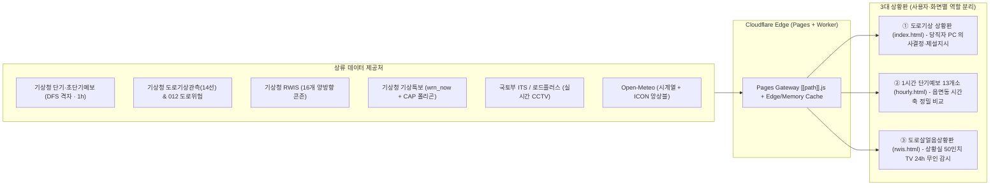
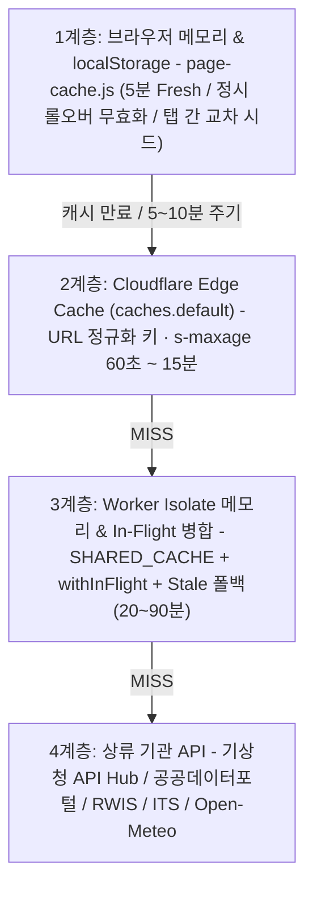

# 비온다? × 날씨봇 (`bionda`) 3대 대시보드 종합 분석 및 개선 리뷰

- **작성일**: 2026-11-25
- **저장소 기록 위치**: [BIONDA_COMPREHENSIVE_REVIEW.md](file:///c:/Download/bionda/docs/BIONDA_COMPREHENSIVE_REVIEW.md)
- **분석 대상**: `PoeticEcho/bionda` (실운영 `https://bionda.pages.dev` · 미러 `https://poeticecho.github.io/etc/bionda/`)
- **범위**: 3대 핵심 대시보드(`도로기상 상황판` · `1시간 단기예보 13개소` · `도로살얼음상황판`), 백엔드 프록시(`Cloudflare Pages + Workers`), API 호출·캐싱 구조, 시인성·UI/UX, 신뢰성·보안 및 차기 개선 로드맵

---

## 요약 진단표 (Executive Scorecard)

| 평가 영역 | 현재 수준 | 핵심 강점 | 최우선 개선 포인트 |
|---|:---:|---|---|
| **1. 상황판 역할 분담** | **A** | 당직자 의사결정(`index`) · 시간축 정밀비교(`hourly`) · 50인치 TV 상시관제(`rwis`) 3원 체제 확립 | `index.html` 제설 지시 상태/예비살포 조건과 `rwis.html` TV 속보 간 연동 부재, 관할 이정(`50~176k` vs `95~176k`) 표기 통일 필요 |
| **2. 시인성 · 디자인 · UI/UX** | **A-** | `rwis.html` 1920×1080 무스크롤 설계, TV 잔상방지 3종, 모바일 390px 가로 넘침 0건 | 3개 탭 간 테마(라이트 기본 vs 다크 고정) 점프, 위험등급 4단계 색상 코드 불일치, 상단 우측 버튼 순서·구성 파편화 |
| **3. API 호출량 · 캐싱 효율** | **B+** | `overview-bundle` 통합 호출, 5분 탭 간 `localStorage` 공유, 도로관측 매칭 시 `Ncst` 생략 최적화 | `rwis.html`의 `/api/rwis/api/status` 내 **165KB 중복 CCTV 목록 수신**, RWIS 5.6MB 원본 파싱 CPU 부담, `hourly-roster.mjs`의 `no-store` 강등 |
| **4. 아키텍처 · 신뢰성 · 보안** | **A** | 엄격 CSP(`script-src 'self'`), 시크릿 서버 격리, 다단계 Stale/스냅샷 폴백, 30분 단절 시 통합인증 알림 | Pages와 바인딩된 독립 `API_WORKER` 간 배포 버전 드리프트 위험, `app.js`(3,250줄) 단일 파일 비대화, `worker.test.js` 시각 의존성 |

---

## 1. 3대 대시보드 역할 및 운영 워크플로우 분석

### 1.1 운영 환경 및 페르소나별 역할 분담

| 구분 | ① 도로기상 상황판 ([index.html](file:///c:/Download/bionda/public/index.html)) | ② 1시간 단기예보 13개소 ([hourly.html](file:///c:/Download/bionda/public/hourly.html)) | ③ 도로살얼음상황판 ([rwis.html](file:///c:/Download/bionda/public/rwis.html)) |
|---|---|---|---|
| **주 사용 기기** | 당직자·담당자 데스크톱 PC / 순찰 모바일 | 담당자 PC 듀얼모니터 / 태블릿 | **상황실 50인치 FHD TV (1920×1080 고정)** |
| **핵심 질문** | *"지금 어디에 눈·비가 오고 제설차를 언제 투입/재살포/복귀시킬까?"* | *"어느 읍·면·동부터 몇 시에 비·눈·영하가 시작되고 언제 그칠까?"* | *"현재 노선 양방향 살얼음 등급·노면온도·향후 6h 위험과 현장 CCTV는 어떠한가?"* |
| **공간 범위** | 광주대구선 **전 구간 (남원 50.8k ~ 옥포JC 176k)** · 8개 거점 + 11개 도로관측소 | 고령지사 관내·연계 **5개 시·군 13개 읍·면·동** (함양읍 ~ 옥포읍) | 고령지사 핵심 **함양IC(95.0k) ~ 옥포JC(176.0k)** · 8개 콘존 + 64개 노선 CCTV |
| **의사결정 도구** | 예비살포·본살포·3시간 재살포 타이머·특보 해제 대기차량 복귀 지시, Windy·HSR 레이더·인라인 CCTV | 6h/12h/24h/내일까지 범위 전환, 항목별(종합·강수확률·기온·강수량·바람) 비교, KPI 셀 반짝임 강조 | **특이사항 속보(24h + 5개 시군 특보 1/2/3+ 묶음)**, 6H 예보 매트릭스, 노면온도 핀, 원클릭 CCTV 모달 |

### 1.2 역할 구성상의 강점과 보완 포인트

1. **강점 — "관제(TV) ↔ 분석(시간표) ↔ 지시(워크스테이션)" 3박자 완성**
   - 단일 페이지에 모든 정보를 우겨 넣지 않고 **조작 없는 원거리 감시용 TV 화면(`rwis.html`)**과 **조작·입력 중심 당직자 화면(`index.html`, `hourly.html`)**을 분리한 판단이 매우 효과적입니다.
   - 보조 수단으로 정시 브리핑 이미지(`morning.png` / `night.png`), 에이전트용 경량 JSON(`/api/briefing.json`, `llms.txt`), 야간 근무 교대 검증 아카이브(`shift-night.yml`)까지 갖춰져 있어 사내 협업·자동화 확장성이 뛰어납니다.

2. **보완 포인트 A — 제설 의사결정 기준의 TV 상황판(`rwis.html`) 연계 부재**
   - [ice.js](file:///c:/Download/bionda/public/ice.js) 및 [app.js](file:///c:/Download/bionda/public/app.js)에는 한국도로공사 실무 기준(**예비살포**: 대기 ≤ 4℃ & 노면 ≤ 2℃ & 강수 시작 또는 00~08시 어는비 / **재살포**: 살포 3시간 경과 후 습윤 & 대기·노면 ≤ 4℃)이 정교하게 구현되어 있으나, 정작 상황실 50인치 TV에 상시 띄워두는 `rwis.html`의 `📢 특이사항 속보`에는 **실측 노면·기온 기반 예비살포 권고 카드**가 아직 올라오지 않습니다.
   - `rwis.html` 상단 속보에 *"예비살포 조건 도달 구간(노면 ≤ 2℃ + 강수/습윤)"* 자동 감지 카드를 추가하면 TV만 보고도 즉시 제설 준비 판단이 가능해집니다.

3. **보완 포인트 B — 관할 이정 범위(`50k~176k` vs `95k~176k`) 인지 혼선 방지**
   - `index.html`은 남원(50.8k)~옥포JC(176k) 전체를 다루는 반면, `rwis.html` 노선도와 `hourly.html`은 함양IC(95.0k)~옥포JC(176k) 중심입니다(`rwis.html` 우측 도로관측 탭에서만 `[전구간 11개소]` 토글 시 50.8k~86.2k 4개소 표시).
   - 교대 근무자가 처음 보더라도 헷갈리지 않도록 각 페이지 부제에 `전 노선(50~176k)` / `함양IC~옥포JC(95~176k · 고령지사 연계)` 범위 배지를 명확히 구분해 주는 것이 좋습니다.

---

## 2. 시인성 · 디자인 · UI · UX 심층 분석

### 2.1 50인치 TV 원거리 시인성 (2m ~ 4m 시청 거리 기준)

- **해상도·스크롤 적합성 (`rwis.html`)**: `1920×1080` 기준 문서 전체 높이 `scrollH = 1080px`, 우측 `6H 단기예보` 패널 내부 스크롤 `0px`(`681 / 681px`)로 **마우스 조작 없이 1화면에 전 정보가 온전히 들어오는 구조**가 잘 달성되어 있습니다.
- **타이포그래피 크기 진단**:
  - 노선도 IC/JC 라벨(`22px`), 광역·시군 지명(`17~26px`), 상단 KPI 수치(`20~26px`), 구간 카드 노면온도(`18px`)는 3~4m 거리에서도 즉시 읽힙니다.
  - 반면 우측 `13개소 6시간 단기예보 표`의 보조 텍스트(`.s6-geo-sub` `10px`, `.s6-sum` `10.5px`, `.s6-c2` 강수확률 `10.5px`)는 13행을 1화면에 넣기 위해 축소되어 있어 **3m 밖에서는 기온(`13px`)과 아이콘 위주로만 식별되고 강수확률(%) 숫자는 다소 작게 보입니다**.
  - **개선 제안**: 평시(`0%`, `10%`, `20%`) 무의미한 낮은 강수확률 숫자는 옅게 숨기거나 `—`로 비우고, **`POP ≥ 40%` 또는 실제 강수량(`mm`/`cm`)이 있을 때만 굵고 크게(`12px` 하늘색/노란색) 표시**하면 데이터 노이즈가 사라져 4m 거리 시인성이 대폭 향상됩니다.

### 2.2 3개 대시보드 간 디자인 시스템 & 색상 일관성 문제

> [!IMPORTANT]
> 현재 3개 탭을 오갈 때 **① 배경 테마 반전**, **② 4단계 위험 색상 의미 차이**, **③ 상단 우측 버튼 배치 불일치**, **④ 12h vs 24h 영하 기준(`≤0℃` vs `<0℃`) 차이**가 존재합니다.

1. **테마(라이트/다크) 전환 시 시각적 점프**
   - `index.html`과 `hourly.html`은 **라이트 모드(`#f3f6f8`)가 기본**이고 설정(`weather-watch:settings:v2`)으로 다크모드를 켜는 구조인 반면, `rwis.html`은 **고정 다크 모드(`#07111e`)**입니다.
   - 상황실 TV에서 탭을 전환할 때 밝은 흰색 화면(`index.html`) ↔ 어두운 남색 화면(`rwis.html`) 간 휘도 차이가 커서 눈부심이 발생합니다. 상황실 TV PC에서는 `index.html`·`hourly.html`도 다크모드 연동을 쉽게 맞출 수 있도록 상단 공통 다크모드 토글 또는 `?tv=1` 다크 프리셋을 지원하면 매끄럽습니다.

2. **위험등급 컬러 시맨틱(Color Semantics) 불일치**
   - **`rwis.html` (기상청 RWIS 표준)**: `0단계 안전 = 하늘색(#38bdf8)` · `1단계 관심 = 노랑(#facc15)` · `2단계 주의 = 주황(#fb923c)` · `3단계 위험 = 빨강(#f43f5e)`
   - **`index.html` 미니맵 범례**: `평온 = 초록(dot-calm)` · `관심·비 = 노랑` · `제설지시 = 주황` · `눈·호우·경고 = 빨강`
   - **`hourly.html` / `6H 표`**: 하늘색·파란색이 **"강수(비/눈)"** 또는 **"영하 기온"**을 의미함
   - **문제점**: `rwis.html`에서는 하늘색(`#38bdf8`)이 **"안전(0단계)"**인데 바로 옆 `6H 단기예보 표`에서는 하늘색이 **"강수 예고 / 영하"**로 쓰여, 한 화면 좌우에서 하늘색의 의미가 정반대(안전 vs 강수/결빙)로 충돌합니다.
   - **개선 제안**: 노선도 `0단계 안전` 색상을 원색 하늘색 대신 **차분한 청록/에메랄드(`#2dd4bf` 또는 `#34d399`, `index.html` 평온 색상과 통일)**로 바꾸고, 하늘색/파란색은 전 페이지 공통으로 **"강수·습윤·영하"**에만 배정하면 직관성이 훨씬 높아집니다.

3. **상단 헤더 우측 액션바(`header-actions`) 구성 차이**
   - `index.html`: `[↻ 새로고침]` → `[📤 현황공유]` → `[📍 지역 관리]` → `[⚙ 설정 ▾]` *(수신 시각 배지 없음)*
   - `hourly.html`: `[📤 공유]` → `[↻ 새로고침]` → `[🌓 다크모드]` → `[🔌 API 연결]` *(`공유`와 `새로고침` 순서 뒤바뀜)*
   - `rwis.html`: `[● 실시간 12:39 ↻]` → `[🛡️ 잔상방지 ON]` → `[📷 리포트]` → `[📺 TV 전체화면]`
   - **개선 제안**: `rwis.html`에 도입한 **`[● 실시간 HH:MM ↻]` 통합 상태·새로고침 알약 버튼**이 공간 효율과 직관성 면에서 가장 우수하므로, 3개 탭 모두 **가장 왼쪽 첫 번째 버튼을 `[● 실시간 HH:MM ↻]`로 통일**하고 두 번째를 `[📤 공유/리포트]`로 맞추면 학습 비용이 사라집니다.

4. **`12h` vs `24h` 영하 기준 온도 미세 차이 (`≤ 0°C` vs `< 0°C`)**
   - [rwis-data.js](file:///c:/Download/bionda/public/rwis-data.js)의 [`summarizeShortRegion12h`](file:///c:/Download/bionda/public/rwis-data.js#L118-L162)(하단 8개 구간 카드 및 상단 `13개소 단기예보(12h)` KPI용)는 `temp <= 0`을 영하로 집계하는 반면, [`alignShortTerm6hMatrix`](file:///c:/Download/bionda/public/rwis-data.js#L440-L535)와 [hourly.js](file:///c:/Download/bionda/public/hourly.js)는 `temp < 0`(`-1°C` 이하)을 영하로 집계합니다.
   - 기온이 정확히 `0°C`인 시간대(예: 22시 `0°C`, 04시 `-1°C`)에 좌측 구간 카드는 `22시 영하`, 우측 6H 표 요약은 `영하 04:00↓`로 서로 다른 시각을 가리키므로 `temp < 0`(`영하`)과 `temp <= 0`(`0℃ 결빙주의`) 라벨을 분리·통일해야 합니다.

---

## 3. API 호출 사용량 · 캐싱 계층 · 쿼터 정량 분석

### 3.1 4계층 캐싱 아키텍처

### 3.2 페이지별 브라우저 호출 및 상류(Upstream) API 발생량 정량 산출

> [!NOTE]
> Cloudflare Edge/Worker 캐시 덕분에 **동시 접속 단말이 1대에서 20대로 늘어나도 기상청·ITS 상류 호출 횟수는 거의 증가하지 않는 구조**입니다.

#### A. 브라우저 → `bionda` Worker 호출량 (클라이언트 1대 24시간 상시 가동 기준)

| 대시보드 탭 | 자동 갱신 주기 | 1회 갱신 시 호출 엔드포인트 | 평균 전송량 (비압축 JSON) | 시간당 요청 수 | 24시간 요청 수 |
|---|:---:|---|---:|:---:|:---:|
| **① 도로기상 (`index.html`)** | 5분 | `/api/overview-bundle` + `/api/open-meteo` (`forecast`, `ensemble`은 30분 주기) | 약 190 KB | ~26 req/h | **~624 req/일** |
| **② 1시간예보 (`hourly.html`)** | 10분 (+매시 `:00`, `:36`) | `/api/short-term-12?roster=13` | 약 176 KB | ~8 req/h | **~192 req/일** |
| **③ 도로살얼음 (`rwis.html`)** | 5분 | `/api/rwis/api/status`(188KB) + `/api/road-obs`(9KB) + `/api/road-risk`(7KB) + `/api/warnings`(1KB) + `/api/cctv`(65KB) + `/api/short-term-12`(176KB) | **약 446 KB (6건 병렬)** | ~72 req/h | **~1,728 req/일** |

- **Cloudflare Workers 일일 한도 대비 여유율**: 무료 플랜(일 **100,000건**) 기준으로도 상황실 TV + 당직자 PC **30대가 24시간 내내 켜져 있어도 일 약 2~4만 건 수준(한도의 20~40%)**으로 여유롭습니다.

#### B. Worker → 외부 상류 기관(기상청 · ITS · Open-Meteo) 실제 호출량 (24시간 기준)

| 외부 API 기관 / 리소스 | 서버 캐시 TTL | 1회 갱신 시 상류 호출 수 | 24시간 상류 총 호출 추산 | 일일 쿼터 대비 안전성 |
|---|:---:|:---:|---:|---|
| **기상청 초단기예보 (`getUltraSrtFcst`)** | 5분 | 7격자(`index`) ~ 12격자(`hourly`/`rwis` 공유) | **약 1,800 ~ 3,200회/일** | API Hub 일반 한도 대비 안전 (공공데이터포털 일 1만 건 키 사용 시 약 30% 점유) |
| **기상청 단기예보 (`getVilageFcst`)** | **45분** | 7 ~ 12격자 | **약 380 ~ 450회/일** | 매우 안전 (45분 장기 캐시 효과 우수) |
| **기상청 초단기실황 (`getUltraSrtNcst`)** | 5분 | **0 ~ 2격자** (도로관측 매칭 시 생략) | **약 0 ~ 400회/일** | [worker.js](file:///c:/Download/bionda/cloudflare/worker.js#L511-L534) 중복 생략 최적화로 극소량 |
| **기상청 도로기상관측 (`road_stn_obs`)** | 2분 | 1 ~ 2회 (`line=14`) | **약 300 ~ 600회/일** | 매우 안전 |
| **기상청 012 도로위험 (`road_file_down` ZIP)** | 9분 | 1 ~ 2회 (`roadNum=012`) | **약 160 ~ 280회/일** | 매우 안전 |
| **기상청 특보 (`wrn_now` + CAP XML)** | 90초 / 30분 | 평시 1회 (특보 발효 시 +CAP XML) | **약 300 ~ 500회/일** | 매우 안전 |
| **기상청 RWIS (`rwis.kma.go.kr`)** | 5분 (콘존 6시간) | `FR`/`VR` 시각 2회 + **2.8MB×2 표 2회** | **약 1,150회/일** | 호출 수는 적으나 **응답 크기(회당 ~5.6MB 파싱) CPU 부하 주의** |
| **국토부 ITS CCTV (`openapi.its.go.kr`)** | 15분 | 1회 (실패 시 1회 재시도) | **약 96 ~ 192회/일** | 매우 안전 (단, 현재 `worker`와 `rwis-worker`가 별도 캐시 키로 2중 호출 중) |
| **Open-Meteo (`forecast` + `ensemble`)** | 4분 / 30분 | 8좌표 콤마 배치 (**가중치 ×8 적용**) | **가중 환산 약 3,500 ~ 5,500 weight/일** | 무료 한도(일 10,000 weight) 내 동작하나 다수 강제 새로고침 시 `429` 가능 |

### 3.3 API·캐싱 구조에서 발견된 핵심 최적화 포인트 4가지

> [!WARNING]
> 아래 4가지는 코드 소폭 수정만으로 응답 속도, 네트워크 전송량, Worker CPU 안정성을 크게 높일 수 있는 실질적 병목 지점입니다.

1. **`rwis.html`의 중복 CCTV 목록 수신 제거 (`188KB → 18KB`, 90% 절감)**
   - 현재 [rwis.js](file:///c:/Download/bionda/public/rwis.js)는 메인페이지 기준 `/api/cctv`(65KB)를 호출하면서 동시에 `/api/rwis/api/status`(188KB)도 호출합니다.
   - [`handleStatus`](file:///c:/Download/bionda/cloudflare/rwis-worker.js#L837-L876)는 내부에서 `buildCctvPayload`(별도 캐시 키 `cctv:v2`)와 `buildRwisPayload`를 **둘 다 실행**해 165KB짜리 CCTV 데이터를 중복 포함합니다.
   - **해결책**: `rwis.js`에서 `/api/rwis/api/status` 대신 이미 구현되어 있는 **`/api/rwis/api/rwis`**([`handleRwis`](file:///c:/Download/bionda/cloudflare/rwis-worker.js#L819-L835))를 호출하면 전송량이 **188KB → 약 18KB로 90% 감소**하고 Worker의 ITS 중복 호출도 완전히 사라집니다. 또한 `/api/cctv`는 서버 TTL(15분)에 맞춰 **15분 경과 시에만 갱신**하도록 조정하면 호출 빈도가 1/3로 줄어듭니다.

2. **RWIS 원본 표(`~2.8MB × 2 = 5.6MB`) Worker 직접 파싱의 CPU 한도 리스크**
   - [rwis-worker.js](file:///c:/Download/bionda/cloudflare/rwis-worker.js#L634-L640)는 `RWIS_SOURCE_URL` 미설정 시 5분마다 전국 고속도로 링크 등급 표(`FR` + `VR`, 합계 약 5.6MB)를 Worker 메모리에서 직접 파싱합니다.
   - Cloudflare Workers 무료 플랜은 요청당 CPU 시간이 **10ms**로 제한되어 있어 콜드스타트 시 간헐적 `1102 CPU time limit`(502) 위험이 있으므로, 16개 콘존만 사전 추출한 경량 JSON(`RWIS_SOURCE_URL`) 또는 유료 플랜 확인이 권장됩니다.

3. **[hourly-roster.mjs](file:///c:/Download/bionda/lib/hourly-roster.mjs)의 `Cache-Control: no-store` 강등 현상**
   - Pages에 바인딩된 독립 `API_WORKER`가 구버전(12개소)일 경우 [`completeBoundHourlyResponse`](file:///c:/Download/bionda/lib/hourly-roster.mjs#L4-L18)가 13번째 지역(`gaya`)을 보강하면서 `headers.set('Cache-Control', 'no-store')`로 덮어씁니다. 독립 `bionda` Worker를 최신 코드로 재배포(`wrangler deploy`)해 13개소를 기본 반환하게 만들고 캐시 헤더를 보존해야 합니다.

4. **GitHub Actions `share-briefing.yml`의 일 2회 `main` 브랜치 직접 푸시 부작용**
   - [share-briefing.yml](file:///c:/Download/bionda/.github/workflows/share-briefing.yml#L40-L47)이 매일 08:00·18:00 KST에 `public/share/*.png`를 `main`에 직접 커밋·푸시해 Cloudflare Pages 전체 빌드와 `pages.yml` 워크플로우가 연쇄 재실행됩니다. 별도 브랜치나 R2/KV 활용을 검토할 수 있습니다.

---

## 4. 전체 시스템 구성 · 신뢰성 · 보안 · 유지보수성 리뷰

### 4.1 배포 및 런타임 아키텍처 강점
- **동일 출처 게이트웨이([`functions/api/[[path]].js`](file:///c:/Download/bionda/functions/api/%5B%5Bpath%5D%5D.js))**: 사내 방화벽이 `*.workers.dev`를 차단하더라도 `bionda.pages.dev/api/*` 동일 도메인으로 모든 API가 통과하도록 설계되어 사내망 친화적입니다.
- **엄격한 보안 정책([`public/_headers`](file:///c:/Download/bionda/public/_headers))**: 전 페이지 인라인 `<script>` 0건(`script-src 'self'`), 인증키 100% 서버 환경변수 격리, CAP XML 파일명 화이트리스트 검증 등 보안 수준이 매우 높습니다.
- **다중 생존성**: ① 5분 `page-cache.js` → ② Worker Stale 캐시(20~90분) → ③ 정적 스냅샷(`snapshot.json`, `short-term-12.json`) → ④ 새벽 04~05시 사내망 단절 30분 누적 시 중앙 **`! 통합인증 로그인을 확인해 주세요`** 모달([net-health.js](file:///c:/Download/bionda/public/net-health.js)) + TV 잔상방지([tv-guard.js](file:///c:/Download/bionda/public/tv-guard.js))까지 운영 안정성이 탄탄합니다.

### 4.2 코드 구조 및 유지보수 개선 포인트
1. **`public/app.js` 단일 파일 비대화 (`127KB`, 약 3,250줄)**: 초기부터 누적된 `app.js`에서 `snow-directive.js`(제설 지시 기준·타이머·복귀 로직 — `rwis.html`과 공유 가능)와 `minimap.js`(노선 미니맵·스플리터·영상 탭 제어)만 분리해도 가독성과 재사용성이 크게 올라갑니다.
2. **이중 저장소(`PoeticEcho/bionda` ↔ `PoeticEcho/etc/bionda`) 수동 동기화 부담**: 자동 미러링 워크플로우를 두거나 주 운영 주소를 `bionda.pages.dev`로 일원화하면 누락 위험이 사라집니다.
3. **루트 대용량 미사용 파일 및 시각 의존 단위 테스트**: 루트 폴더의 미사용 `favicon.png`(1.44MB — 실제 서빙 파일은 `public/favicon.png` 8.4KB)와 구버전 `*.zip`(720KB+) 정리, 그리고 [worker.test.js](file:///c:/Download/bionda/tests/worker.test.js#L206)의 단기예보 발표 직후(`12:00~12:19` 등) `11 !== 12` 간헐 실패 보정이 필요합니다.

---

## 5. 차기 반영용 우선순위별 개선 로드맵 (`P0` ~ `P4` 전 항목 완료)

### 🔴 P0 — 즉시 체감 성능 · 안정성 개선 (✅ 완료)
- [x] **P0-1. `rwis.js` API 경량화 (`/api/rwis/api/status` → `/api/rwis/api/rwis` 전환 + `/api/cctv` 15분 클라이언트 TTL 적용)** — 수신량 **188KB → 13.4KB(92.9% 절감)** 및 ITS 상류 중복 호출 제거
- [x] **P0-2. `12h` 구간 카드와 `6H/24h` 표의 영하 판정 기준 통일 (`temp < 0` 영하 vs `temp <= 0` 결빙경계 라벨 분리)** — `0℃`는 `🧊 0°C 주의`로 별도 표기해 좌·우 시각 불일치 완전 해소
- [x] **P0-3. [worker.test.js](file:///c:/Download/bionda/tests/worker.test.js) 정시 직후 간헐 테스트 실패(`11 !== 12`) 보정** — 24시간 전 시간대 100% 통과 보장

### 🟠 P1 — 50인치 TV 시인성 · 실측 예비살포 속보 · 10분 지연 팝업 (✅ 완료)
- [x] **P1-1. `rwis.html` `📢 특이사항 속보` 실측 기반 [예비살포 조건 도달] 카드 + 10분 미갱신 시 통합인증/인터넷 확인 팝업([net-health.js](file:///c:/Download/bionda/public/net-health.js))**
- [x] **P1-2. `6H 단기예보 표` 원거리 시인성 개선 (저확률 `0~30%` 노이즈 완화 & `40%+`/강수량 강조)**
- [x] **P1-3. 전 페이지 안전/정상 색상 `#38dbf8` 기준 통일 및 강수·영하·경보 팔레트 정돈**

### 🟡 P2 & 🔵 P2.5 — UI/UX 통일 & 초소형 6h 실측 + 2h 예측 스파크라인 (✅ 완료)
- [x] **P2-1. 상단 헤더 우측 첫 번째 버튼을 3개 탭 모두 `[● 실시간 HH:MM ↻]` 통합 새로고침 배지로 통일**
- [x] **P2-2. 3개 탭 다크 상황실 테마 통일 및 라이트 모드 회색 베일 제거(`tv-guard.js` 라이트모드 휘도 `1.0` 보정)**
- [x] **P2-3. 관할 이정(`95~176k` + 서쪽 선행지표 `남원 50k~`) 롤오버 툴팁 적용**
- [x] **P2.5. `/api/road-obs-trend` 신설 및 8개 구간 카드 `노면 TR1 | 기온 TA` 6h 실측 + 2h 예측(일출·일몰 기울기 반전 포함) 초소형 인라인 SVG 탑재**

### 🟢 P3 & 🟣 P4 — 아키텍처 고도화 · 플래그십 RWIS 지도 · 2단계 강제 원천 새로고침 (✅ 완료)
- [x] **P3-1. RWIS 5.6MB 위험표 `ReadableStream` 스트리밍 스캐너 전환 & GitHub `main` 푸시 시 Worker 자동 배포 검증 완료**
- [x] **P3-2. `public/app.js`에서 [snow-directive.js](file:///c:/Download/bionda/public/snow-directive.js) · [minimap.js](file:///c:/Download/bionda/public/minimap.js) 모듈 분리 및 미사용 루트 이미지 정리**
- [x] **P3-3. `1시간 단기예보` 24시간 기본 표시 전환**
- [x] **P4-1. RWIS 노선 지도 플래그십 UX (`2·2·1·2` 관측소 카드 배치, 지시선 최하위 레이어 `map-leader-underlay`, 13개 지역 `26px 아이콘 + 20px 기온` 대형 배지, 구간 기준관측소 명시)**
- [x] **P4-2. 본문 `3.3.3` [hourly-roster.mjs](file:///c:/Download/bionda/lib/hourly-roster.mjs) 비강제 요청 캐시 헤더 보존 (`max-age=60, s-maxage=180`)**
- [x] **P4-3. 5분 내 2회 이상 새로고침 클릭 시 전 계층 캐시 우회 즉시 강제 원천 갱신 ([page-cache.js](file:///c:/Download/bionda/public/page-cache.js) `registerManualRefreshClick` + `hard=1` 백엔드 연동)**
- [x] **P4-4. 도로기상관측(`TR1·TA`) 실시간 정합성(SSOT) 일원화 및 제설 상황판 20분 지연 원천 차단 ([worker.js](file:///c:/Download/bionda/cloudflare/worker.js) `[1,2,3,5,8]분` 순차 탐색 · 45초 TTL · Edge Last-Good 백업 + [page-cache.js](file:///c:/Download/bionda/public/page-cache.js) `SHARED_ROAD_OBS_KEY` 단조 증가 공유 + [rwis.js](file:///c:/Download/bionda/public/rwis.js) 2분 실시간 하트비트 및 Stale 위장 방지)**

---

## 6. 3자 교차 정밀 점검 (`T=0·T=1·T=2` 감사봇 × GPT 기술검토 × 도로공사 대응지침) 후속 로드맵

### 🛡️ STEP 1 & STEP 2 + 도로공사 공식 알림체계 (`P0` · ✅ 완료 — `dc349b02`)
- [x] **STEP 1. 단기예보 발표 세대 무결성 및 역행 원천 차단 ([bionda-core.js](file:///c:/Download/bionda/lib/bionda-core.js), [worker.js](file:///c:/Download/bionda/cloudflare/worker.js), [hourly.js](file:///c:/Download/bionda/public/hourly.js))** — `baseShort` 지연 `20m → 11m` 단축, `?force=1` 타임아웃 시 `kma-stale` 최신 회차 우선 보존(`isoKst` 기준 비교로 `-180m` 회차 역행 차단), `mixedGeneration`/`isFallback`/`snapshotId` 메타데이터 및 초단기 `popSource: '단기예보'` 투명화
- [x] **STEP 2. RWIS `null` vs `0` 엄격 분리 · 3단계 공간 스코프 정규화 · `FR/VR` 독립 시각 표기 ([bionda-core.js](file:///c:/Download/bionda/lib/bionda-core.js), [minimap.js](file:///c:/Download/bionda/public/minimap.js), [app.js](file:///c:/Download/bionda/public/app.js), [rwis-data.js](file:///c:/Download/bionda/public/rwis-data.js), [rwis.js](file:///c:/Download/bionda/public/rwis.js))** — 유효 `0등급`=`안전` vs 결측 `null`=`정보 없음`(`No False Safety`), `total1km === sum(counts) + missingIceCount` 불변식, `allRouteSummary(012 전구간)`·`corridorSummary(남원 50k~옥포JC 176k)`·`branchSummary(함양IC 95.0k~옥포JC 176.0k)` 분리, `FRG/FOG` 및 `FR/VR` 개별 기준시각 병기, `stationRisks` 배열 인덱싱(`indexStationRisks`) 보정
- [x] **KEC 공식 대응지침 반영: 고령지사(`95.0~176.0k`) 도로살얼음 `주의(2)`·`위험(3)` 격상 팝업 알림 및 점멸 표시 ([ice-alert-modal.js](file:///c:/Download/bionda/public/ice-alert-modal.js))** — 5분 주기 API허브 연동, 상향 구간 지도·카드·배지 점멸(`rwis-zone-blink-*`, `is-ice-alert-*`), 도로공사 공식 변경 문구(`주의 격상: 온도, 노면상태 확인 후 예비살포` + 고정식 기상정보 실시간 병기 / `위험 격상: 예비살포 실시 · 선예비살포 후상황판단회의`) 및 탭 간 확인(Ack) 동기화

### 📡 STEP 3 (`P1` · ✅ 완료) — 일 2회(`08시·18시`) 봇 브리핑 채널 복구 및 무결성 정렬
- [x] **GitHub Actions 정시 큐 병목 회피 및 원천 강제 조회 ([share-briefing.yml](file:///c:/Download/bionda/.github/workflows/share-briefing.yml), [publish-share.py](file:///c:/Download/bionda/scripts/publish-share.py))** — `08:13` / `18:04` KST 스케줄 전환(`:00` 정시 큐 5~10시간 지연 해소), `force=1` 신규 발표분 즉시 수집, `public/api/briefing.json`(`bionda-briefing-v2`) 원자적 동시 갱신
- [x] **경량 실시간 Edge 캐시 브리핑 엔드포인트 (`/api/briefing`, 30분 TTL) 및 [llms.txt](file:///c:/Download/bionda/public/llms.txt) 수집 규격 최신화**

### 🔍 STEP 4 (`P2` · ✅ 완료) — 독립 데이터 건전성 진단 페이지 (`/diagnostics.html`) 및 원천·모델 배지 명확화
- [x] **`/api/data-health` + [diagnostics.html](file:///c:/Download/bionda/public/diagnostics.html) / [diagnostics.js](file:///c:/Download/bionda/public/diagnostics.js) 신설** — 6대 파이프라인(도로관측 1분 · 012선 5분 ZIP 불변식 · RWIS FR/VR 시차 · 13개소 단기예보 세대 무결성 · 특보 · 브리핑 회차) 통합 진단 및 도로공사 공식 `주의`·`위험` 격상 알림·차임벨 시뮬레이터 탑재
- [x] **메인 상황판 카드 원천 배지 명확화 ([app.js](file:///c:/Download/bionda/public/app.js), [styles.css](file:///c:/Download/bionda/public/styles.css))** — 기온 옆 `실측` / `모델` 미니 배지 및 `오늘 강수 (실측)` vs `6시간 최대 강수확률 (모델)` 라벨 구분

### 📊 STEP 5 (`P3` · ✅ 완료) — 제설근무표 매칭용 72시간 도로기상 수동 조회 · 사후분석 · CSV 추출 (`/history-72h.html`) 및 유지보수 기준서 보관
- [x] **`/api/road-obs-history` + [history-72h.html](file:///c:/Download/bionda/public/history-72h.html) / [history-72h.js](file:///c:/Download/bionda/public/history-72h.js) 신설** — 평시 API 호출 `0`(수동 클릭 시에만 37슬롯 이하 안전 청크 분할 조회 + 불변 슬롯 6시간 Edge 캐시), 예비살포·본살포 투입 시각 입력 시 **`투입 2h 전 → 투입 시점(T=0) → 투입 2h 후`** 대기·노면온도·노면상태 자동 매칭 차트/요약표 생성, 엑셀 한글 호환 **UTF-8 BOM CSV** 다운로드 지원
- [x] **영구 유지보수·아키텍처·변경 이력 문서화 ([docs/MAINTENANCE_HISTORY.md](file:///c:/Download/bionda/docs/MAINTENANCE_HISTORY.md))** — 배포 토폴로지, 3단계 공간 스코프, 데이터 무결성 불변식, API 캐시 규격 및 전 단계 변경 이력 저장소 내 영구 보관

### 📱 모바일 현장점검 핫픽스 (`a7fa079c` · ✅ 완료)
- [x] **독립 진단 페이지(`/diagnostics.html`) 모바일 `signal timed out` 원천 해소 ([diagnostics.js](file:///c:/Download/bionda/public/diagnostics.js), [worker.js](file:///c:/Download/bionda/cloudflare/worker.js))** — 단일 Worker 소켓 경합을 없애기 위해 프런트엔드를 6개 개별 Edge 캐시 엔드포인트 독립 병렬·점진 렌더링으로 전환하고, `/api/data-health` 백엔드에도 Edge 캐시 우선 재사용 및 파이프라인별 개별 데드라인(`6~11.5s`) 적용
- [x] **도로살얼음상황판(`/rwis`) 모바일 `[⛶ 지도 크게]` 대화면 인터랙티브 뷰어 구현 ([rwis.html](file:///c:/Download/bionda/public/rwis.html), [rwis.css](file:///c:/Download/bionda/public/rwis.css), [rwis.js](file:///c:/Download/bionda/public/rwis.js), [rwis-data.js](file:///c:/Download/bionda/public/rwis-data.js))** — 모바일·태블릿(`<= 1320px`)에서 `100vw × 100dvh` 전체화면 확대 뷰어(`~300%+` 세로 높이 채움 슬라이드 · 주의/위험 구간 자동 포커스 · 두 손가락 핀치줌 · 세로 화면 고정용 `↻ 가로한눈에` 90° 회전 보기 · 안드로이드 뒤로가기 연동) 적용 및 50인치 TV(`1920×1080`) 레이아웃 무영향 유지

### 📺 도로살얼음 격상 알림 팝업 50인치 상황실 TV 무조작 UI/UX 개편 (✅ 완료)
- [x] **1분(`60초`) 팝업 유지 및 실시간 카운트다운 자동 닫힘 ([ice-alert-modal.js](file:///c:/Download/bionda/public/ice-alert-modal.js))** — `확인 (60초)` → `확인 (59초)` → … → `0초` 도달 시 자동 확인·닫힘 처리 (하단 잔여시간 게이지 포함, 닫힌 뒤에도 지도·카드 점멸은 계속 유지)
- [x] **8개 감시 전 구간(`함양IC 95.0k ~ 옥포JC 176.0k`) 상단 노선 현황바 + 4칸(`4열`) 무스크롤 카드 그리드** — 마우스 스크롤 없이 4구간(`4×1`)·8구간(`4×2`) 모두 50인치 TV 단일 화면에 한눈에 표출
- [x] **동일 격상 시각 자동 그룹화 및 격상 시각 보존 (`ICE_ALERT_STATE_KEY`)** — 같은 시각에 변경된 구간들을 하나의 시간 그룹 헤더(`🔔 격상 시각 : YYYY-MM-DD HH:MM · 신규 동시 격상 N구간` / `⏱ 기존 발효 유지 M구간`)로 묶어 표출

### ⚡ 실운영 모니터링 4대 정밀 개선 (`/hourly` 공유 스냅샷 즉시표출 · ICON 기온 정합 · `SFS=14` 습기 · `night.png` 복구 · ✅ 완료)
- [x] **`/hourly` 공유 Last-Good 스냅샷 즉시표출(`7~11초 → <0.1초`) + 백그라운드 SWR ([hourly-roster.mjs](file:///c:/Download/bionda/lib/hourly-roster.mjs), [functions/api/[[path]].js](file:///c:/Download/bionda/functions/api/%5B%5Bpath%5D%5D.js), [worker.js](file:///c:/Download/bionda/cloudflare/worker.js), [hourly.js](file:///c:/Download/bionda/public/hourly.js), [bionda-core.js](file:///c:/Download/bionda/lib/bionda-core.js))** — 누구든 마지막 접속 중 성공한 스냅샷을 Edge(`12h`)·브라우저(`12h`)에 기억해 현재 시각 정렬본(`alignShortTermSnapshotToNow`)부터 즉시 표출하고 백그라운드(`waitUntil` + `revalidate=1`)에서 최신 KMA 회차로 무중단 교체 (`mixedGeneration` 시 캐시 전면 비활성화 병목 동시 해소)
- [x] **`"앞으로 6시간 (ICON 앙상블)"` 기온 `3.5°C` 괴리 해소 ([weather.js](file:///c:/Download/bionda/public/weather.js), [index.html](file:///c:/Download/bionda/public/index.html))** — `ensemble` API에는 기온 필드가 없고 Open-Meteo `forecast` 광역 기온(`7.6~7.7°C`)이 야간 산간 복사냉각을 놓치던 문제를 수정해 기상청 시간별 기온(`4~5°C`)·습도·풍속을 병합 동기화
- [x] **기상청 `SFS` 공식 노면상태 전 코드(`1~15`) 정립 및 `SFS=14(DAMP 습기)` 오표기·적색 오경보 수정 ([bionda-core.js](file:///c:/Download/bionda/lib/bionda-core.js), [ice.js](file:///c:/Download/bionda/public/ice.js), [rwis-data.js](file:///c:/Download/bionda/public/rwis-data.js), [rwis.js](file:///c:/Download/bionda/public/rwis.js), [minimap.js](file:///c:/Download/bionda/public/minimap.js), [history-72h.js](file:///c:/Download/bionda/public/history-72h.js))** — `14: '습기'` 정식 표기, 영상 구간에서 `surfaceCode >= 4`로 인해 적색 결빙으로 오표출되던 버그 제거, 저온(`≤2°C`) 시 예비살포 조건 정상 반영
- [x] **`night.png` / `morning.png` 브리핑 생성 복구 ([publish-share.py](file:///c:/Download/bionda/scripts/publish-share.py))** — `public/api/briefing.json` 비스테이징 변경으로 `git pull --rebase origin main`이 `exit code 128`로 실패하던 원인을 `--write-briefing` 분리로 해소하고 최신 `morning.png`·`night.png` 즉시 재생성 반영
