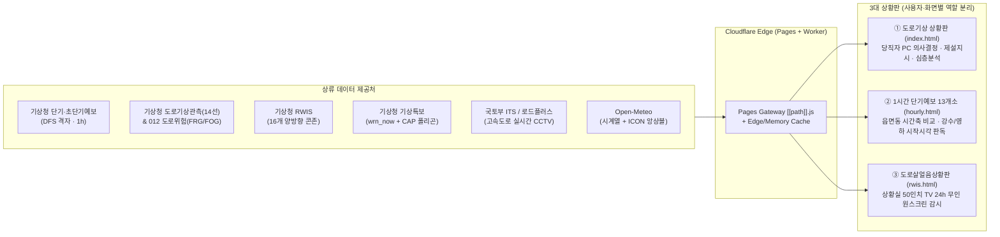
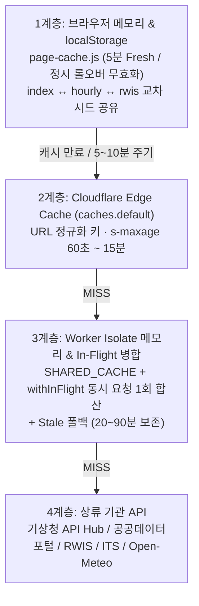

# 비온다? × 날씨봇 (`bionda`) 3대 대시보드 종합 분석 및 개선 리뷰

- **작성일**: 2026-11-25
- **분석 대상**: `PoeticEcho/bionda` (실운영 `https://bionda.pages.dev` · 미러 `https://poeticecho.github.io/etc/bionda/`)
- **범위**: 3대 핵심 대시보드(`도로기상 상황판` · `1시간 단기예보 13개소` · `도로살얼음상황판`), 백엔드 프록시(`Cloudflare Pages + Workers`), API 호출·캐싱 구조, 시인성·UI/UX, 신뢰성·보안 및 차기 개선 로드맵

---

## 요약 진단표 (Executive Scorecard)

| 평가 영역 | 현재 수준 | 핵심 강점 | 최우선 개선 포인트 |
|---|:---:|---|---|
| **1. 상황판 역할 분담** | **A** | 당직자 의사결정(`index`) · 시간축 정밀비교(`hourly`) · 50인치 TV 상시관제(`rwis`) 3원 체제 확립 | `index.html` 제설 지시 상태/예비살포 조건과 `rwis.html` TV 속보 간 연동 부재, 관할 이정(`50~176k` vs `95~176k`) 표기 통일 필요 |
| **2. 시인성 · 디자인 · UI/UX** | **A-** | `rwis.html` 1920×1080 무스크롤 설계, TV 잔상방지 3종, 모바일 390px 가로 넘침 0건 | 3개 탭 간 테마(라이트 기본 vs 다크 고정) 점프, 위험등급 4단계 색상 코드 불일치, 상단 우측 버튼 순서·구성 파편화 |
| **3. API 호출량 · 캐싱 효율** | **B+** | `overview-bundle` 통합 호출, 5분 탭 간 `localStorage` 공유, 도로관측 매칭 시 `Ncst` 생략 최적화 | `rwis.html`의 `/api/rwis/api/status` 내 **165KB 중복 CCTV 목록 수신**, RWIS 5.6MB 원본 파싱 CPU 부담, `hourly-roster.mjs`의 `no-store` 강등 |
| **4. 아키텍처 · 신뢰성 · 보안** | **A** | 엄격 CSP(`script-src 'self'`), 시크릿 서버 격리, 다단계 Stale/스냅샷 폴백, 30분 단절 시 통합인증 알림 | Pages와 바인딩된 독립 `API_WORKER` 간 배포 버전 드리프트 위험, `app.js`(3,250줄) 단일 파일 비대화, `worker.test.js` 시각 의존성 |

---

## 1. 3대 대시보드 역할 및 운영 워크플로우 분석

### 1.1 운영 환경 및 페르소나별 역할 분담

| 구분 | ① 도로기상 상황판 ([index.html](file:///c:/Download/bionda/public/index.html)) | ② 1시간 단기예보 13개소 ([hourly.html](file:///c:/Download/bionda/public/hourly.html)) | ③ 도로살얼음상황판 ([rwis.html](file:///c:/Download/bionda/public/rwis.html)) |
|---|---|---|---|
| **주 사용 기기** | 당직자·담당자 데스크톱 PC / 순찰 모바일 | 담당자 PC 듀얼모니터 / 태블릿 | **상황실 50인치 FHD TV (1920×1080 고정)** |
| **핵심 질문** | *"지금 어디에 눈·비가 오고 제설차를 언제 투입/재살포/복귀시킬까?"* | *"어느 읍·면·동부터 몇 시에 비·눈·영하가 시작되고 언제 그칠까?"* | *"현재 노선 양방향 살얼음 등급·노면온도·향후 6h 위험과 현장 CCTV는 어떠한가?"* |
| **공간 범위** | 광주대구선 **전 구간 (남원 50.8k ~ 옥포JC 176k)** · 8개 거점 + 11개 도로관측소 | 고령지사 관내·연계 **5개 시·군 13개 읍·면·동** (함양읍 ~ 옥포읍) | 고령지사 핵심 **함양IC(95.0k) ~ 옥포JC(176.0k)** · 8개 콘존 + 64개 노선 CCTV |
| **의사결정 도구** | 예비살포·본살포·3시간 재살포 타이머·특보 해제 대기차량 복귀 지시, Windy·HSR 레이더·인라인 CCTV | 6h/12h/24h/내일까지 범위 전환, 항목별(종합·강수확률·기온·강수량·바람) 비교, KPI 셀 반짝임 강조 | **특이사항 속보(24h + 5개 시군 특보 1/2/3+ 묶음)**, 6H 예보 매트릭스, 노면온도 핀, 원클릭 CCTV 모달 |

### 1.2 역할 구성상의 강점과 보완 포인트

1. **강점 — "관제(TV) ↔ 분석(시간표) ↔ 지시(워크스테이션)" 3박자 완성**
   - 단일 페이지에 모든 정보를 우겨 넣지 않고 **조작 없는 원거리 감시용 TV 화면(`rwis.html`)**과 **조작·입력 중심 당직자 화면(`index.html`, `hourly.html`)**을 분리한 판단이 매우 효과적입니다.
   - 보조 수단으로 정시 브리핑 이미지(`morning.png` / `night.png`), 에이전트용 경량 JSON(`/api/briefing.json`, `llms.txt`), 야간 근무 교대 검증 아카이브(`shift-night.yml`)까지 갖춰져 있어 사내 협업·자동화 확장성이 뛰어납니다.

2. **보완 포인트 A — 제설 의사결정 기준의 TV 상황판(`rwis.html`) 연계 부재**
   - [ice.js](file:///c:/Download/bionda/public/ice.js) 및 [app.js](file:///c:/Download/bionda/public/app.js)에는 한국도로공사 실무 기준(**예비살포**: 대기 ≤ 4℃ & 노면 ≤ 2℃ & 강수 시작 또는 00~08시 어는비 / **재살포**: 살포 3시간 경과 후 습윤 & 대기·노면 ≤ 4℃)이 정교하게 구현되어 있으나, 정작 상황실 50인치 TV에 상시 띄워두는 `rwis.html`의 `📢 특이사항 속보`에는 **실측 노면·기온 기반 예비살포 권고 카드**가 아직 올라오지 않습니다.
   - `rwis.html` 상단 속보에 *"예비살포 조건 도달 구간(노면 ≤ 2℃ + 강수/습윤)"* 자동 감지 카드를 추가하면 TV만 보고도 즉시 제설 준비 판단이 가능해집니다.

3. **보완 포인트 B — 관할 이정 범위(`50k~176k` vs `95k~176k`) 인지 혼선 방지**
   - `index.html`은 남원(50.8k)~옥포JC(176k) 전체를 다루는 반면, `rwis.html` 노선도와 `hourly.html`은 함양IC(95.0k)~옥포JC(176k) 중심입니다.(`rwis.html` 우측 도로관측 탭에서만 `[전구간 11개소]` 토글 시 50.8k~86.2k 4개소 표시).
   - 교대 근무자가 처음 보더라도 헷갈리지 않도록 각 페이지 부제에 `전 노선(50~176k)` / `함양IC~옥포JC(95~176k · 고령지사 연계)` 범위 배지를 명확히 구분해 주는 것이 좋습니다.

---

## 2. 시인성 · 디자인 · UI · UX 심층 분석

### 2.1 50인치 TV 원거리 시인성 (2m ~ 4m 시청 거리 기준)

- **해상도·스크롤 적합성 (`rwis.html`)**: `1920×1080` 기준 문서 전체 높이 `scrollH = 1080px`, 우측 `6H 단기예보` 패널 내부 스크롤 `0px`(`681 / 681px`)로 **마우스 조작 없이 1화면에 전 정보가 온전히 들어오는 구조**가 잘 달성되어 있습니다.
- **타이포그래피 크기 진단**:
  - 노선도 IC/JC 라벨(`22px`), 광역·시군 지명(`17~26px`), 상단 KPI 수치(`20~26px`), 구간 카드 노면온도(`18px`)는 3~4m 거리에서도 즉시 읽힙니다.
  - 반면 우측 `13개소 6시간 단기예보 표`의 보조 텍스트(`.s6-geo-sub` `10px`, `.s6-sum` `10.5px`, `.s6-c2` 강수확률 `10.5px`)는 13행을 1화면에 넣기 위해 축소되어 있어 **3m 밖에서는 기온(`13px`)과 아이콘 위주로만 식별되고 강수확률(%) 숫자는 다소 작게 보입니다**.
  - **개선 제안**: 평시(`0%`, `10%`, `20%`) 무의미한 낮은 강수확률 숫자는 옅게 숨기거나 `—`로 비우고, **`POP ≥ 40%` 또는 실제 강수량(`mm`/`cm`)이 있을 때만 굵고 크게(`12px` 하늘색/노란색) 표시**하면 데이터 노이즈가 사라져 4m 거리 시인성이 대폭 향상됩니다.

### 2.2 3개 대시보드 간 디자인 시스템 & 색상 일관성 문제

> [!IMPORTANT]
> 현재 3개 탭을 오갈 때 **① 배경 테마 반전**, **② 4단계 위험 색상 의미 차이**, **③ 상단 우측 버튼 배치 불일치**가 존재합니다.

1. **테마(라이트/다크) 전환 시 시각적 점프**
   - `index.html`과 `hourly.html`은 **라이트 모드(`#f3f6f8`)가 기본**이고 설정(`weather-watch:settings:v2`)으로 다크모드를 켜는 구조인 반면, `rwis.html`은 **고정 다크 모드(`#07111e`)**입니다.
   - 상황실 TV에서 탭을 전환할 때 밝은 흰색 화면(`index.html`) ↔ 어두운 남색 화면(`rwis.html`) 간 휘도 차이가 커서 눈부심이 발생합니다. `rwis.html`은 TV 전용 다크를 기본 유지하되, 상황실 TV PC에서는 `index.html`·`hourly.html`도 다크모드 연동을 쉽게 맞출 수 있도록 상단 공통 다크모드 토글 또는 `?tv=1` 다크 프리셋을 지원하면 매끄럽습니다.

2. **위험등급 컬러 시맨틱(Color Semantics) 불일치**
   - **`rwis.html` (기상청 RWIS 표준)**: `0단계 안전 = 하늘색(#38bdf8)` · `1단계 관심 = 노랑(#facc15)` · `2단계 주의 = 주황(#fb923c)` · `3단계 위험 = 빨강(#f43f5e)`
   - **`index.html` 미니맵 범례**: `평온 = 초록(dot-calm)` · `관심·비 = 노랑` · `제설지시 = 주황` · `눈·호우·경고 = 빨강`
   - **`hourly.html` / `6H 표`**: 하늘색·파란색이 **"강수(비/눈)"** 또는 **"영하 기온"**을 의미함
   - **문제점**: `rwis.html`에서는 하늘색(`#38bdf8`)이 **"안전(0단계)"**인데 바로 옆 `6H 단기예보 표`에서는 하늘색이 **"강수 예고 / 영하"**로 쓰여, 한 화면 좌우에서 하늘색의 의미가 정반대(안전 vs 강수/결빙)로 충돌합니다.
   - **개선 제안**: 노선도 `0단계 안전` 색상을 기상청 원색 하늘색 대신 **차분한 청록/에메랄드(`#2dd4bf` 또는 `#34d399`, `index.html` 평온 색상과 통일)**로 바꾸고, 하늘색/파란색은 전 페이지 공통으로 **"강수·습윤·영하"**에만 배정하면 직관성이 훨씬 높아집니다.

3. **상단 헤더 우측 액션바(`header-actions`) 구성 차이**
   - `index.html`: `[↻ 새로고침]` → `[📤 현황공유]` → `[📍 지역 관리]` → `[⚙ 설정 ▾]` *(수신 시각 배지 없음)*
   - `hourly.html`: `[📤 공유]` → `[↻ 새로고침]` → `[🌓 다크모드]` → `[🔌 API 연결]` *(`공유`와 `새로고침` 순서 뒤바뀜)*
   - `rwis.html`: `[● 실시간 12:39 ↻]` → `[🛡️ 잔상방지 ON]` → `[📷 리포트]` → `[📺 TV 전체화면]`
   - **개선 제안**: `rwis.html`에 도입한 **`[● 실시간 HH:MM ↻]` 통합 상태·새로고침 알약 버튼**이 공간 효율과 직관성 면에서 가장 우수하므로, 3개 탭 모두 **가장 왼쪽 첫 번째 버튼을 `[● 실시간 HH:MM ↻]`로 통일**하고 두 번째를 `[📤 공유/리포트]`로 맞추면 학습 비용이 사라집니다.

4. **`12h` vs `24h` 영하 기준 온도 미세 차이 (`≤ 0°C` vs `< 0°C`)**
   - [rwis-data.js](file:///c:/Download/bionda/public/rwis-data.js)의 [`summarizeShortRegion12h`](file:///c:/Download/bionda/public/rwis-data.js#L118-L162)(하단 8개 구간 카드 및 상단 `13개소 단기예보(12h)` KPI용)는 `temp <= 0`을 영하로 집계하는 반면, [`alignShortTerm6hMatrix`](file:///c:/Download/bionda/public/rwis-data.js#L440-L535)와 [hourly.js](file:///c:/Download/bionda/public/hourly.js)는 `temp < 0`(`-1°C` 이하)을 영하로 집계합니다.
   - 이 때문에 기온이 정확히 `0°C`인 시간대(예: 22시 `0°C`, 04시 `-1°C`)에 좌측 구간 카드는 `22시 영하`, 우측 6H 표 요약은 `영하 04:00↓`로 서로 다른 시각을 가리킵니다. 기준을 `temp <= 0` (`0℃ 이하 결빙주의`) 또는 `temp < 0` (`영하`) 중 하나로 통일하고 라벨을 명확히 맞추어야 합니다.

---

## 3. API 호출 사용량 · 캐싱 계층 · 쿼터 정량 분석

### 3.1 4계층 캐싱 아키텍처

### 3.2 페이지별 브라우저 호출 및 상류(Upstream) API 발생량 정량 산출

> [!NOTE]
> 아래 수치는 **상황실 PC/TV 1대가 24시간 상시 켜져 있을 때**와 **10대가 동시 접속할 때**의 실제 코드 기준 호출량입니다. Cloudflare Edge/Worker 캐시 덕분에 **클라이언트 대수가 1대에서 20대로 늘어나도 기상청·ITS 상류 호출 횟수는 거의 증가하지 않는 구조**입니다(Open-Meteo 직접 폴백 제외).

#### A. 브라우저 → `bionda` Worker 호출량 (클라이언트 1대 기준)

| 대시보드 탭 | 자동 갱신 주기 | 1회 갱신 시 호출 엔드포인트 | 평균 전송량 (비압축 JSON) | 시간당 요청 수 | 24시간 요청 수 |
|---|:---:|---|---:|:---:|:---:|
| **① 도로기상 (`index.html`)** | 5분 | `/api/overview-bundle` + `/api/open-meteo` (`forecast`, `ensemble`은 30분 주기) | 약 190 KB | ~26 req/h | **~624 req/일** |
| **② 1시간예보 (`hourly.html`)** | 10분 (+매시 `:00`, `:36`) | `/api/short-term-12?roster=13` | 약 176 KB | ~8 req/h | **~192 req/일** |
| **③ 도로살얼음 (`rwis.html`)** | 5분 | `/api/rwis/api/status`(188KB) + `/api/road-obs`(9KB) + `/api/road-risk`(7KB) + `/api/warnings`(1KB) + `/api/cctv`(65KB) + `/api/short-term-12`(176KB) | **약 446 KB (6건 병렬)** | ~72 req/h | **~1,728 req/일** |

- **Cloudflare Workers 일일 한도 대비 여유율**: 무료 플랜(일 **100,000건**) 기준으로도 상황실 TV + 당직자 PC **30대가 24시간 내내 켜져 있어도 일 약 2~4만 건 수준(한도의 20~40%)**으로 매우 여유롭습니다.

#### B. Worker → 외부 상류 기관(기상청 · ITS · Open-Meteo) 실제 호출량 (24시간 기준)

| 외부 API 기관 / 리소스 | 서버 캐시 TTL | 1회 갱신 시 상류 호출 수 | 24시간 상류 총 호출 추산 | 일일 쿼터 대비 안전성 |
|---|:---:|:---:|---:|---|
| **기상청 초단기예보 (`getUltraSrtFcst`)** | 5분 | 7격자(`index`) ~ 12격자(`hourly`/`rwis` 공유) | **약 1,800 ~ 3,200회/일** | API Hub 일반 한도 대비 안전 (단, 공공데이터포털 일 1만 건 키 사용 시 30% 점유) |
| **기상청 단기예보 (`getVilageFcst`)** | **45분** | 7 ~ 12격자 | **약 380 ~ 450회/일** | 매우 안전 (45분 장기 캐시 효과 우수) |
| **기상청 초단기실황 (`getUltraSrtNcst`)** | 5분 | **0 ~ 2격자** (도로관측 매칭 시 생략!) | **약 0 ~ 400회/일** | [worker.js](file:///c:/Download/bionda/cloudflare/worker.js#L511-L534) 중복 생략 최적화로 극소량 |
| **기상청 도로기상관측 (`road_stn_obs`)** | 2분 | 1 ~ 2회 (`line=14`) | **약 300 ~ 600회/일** | 매우 안전 |
| **기상청 012 도로위험 (`road_file_down` ZIP)** | 9분 | 1 ~ 2회 (`roadNum=012`) | **약 160 ~ 280회/일** | 매우 안전 |
| **기상청 특보 (`wrn_now` + CAP XML)** | 90초 / 30분 | 평시 1회 (특보 발효 시 +CAP XML) | **약 300 ~ 500회/일** | 매우 안전 |
| **기상청 RWIS (`rwis.kma.go.kr`)** | 5분 (콘존 6시간) | `FR`/`VR` 시각 2회 + **2.8MB×2 표 2회** | **약 1,150회/일** | 호출 수는 적으나 **응답 크기(회당 ~5.6MB 파싱) CPU 부하 주의** |
| **국토부 ITS CCTV (`openapi.its.go.kr`)** | 15분 | 1회 (실패 시 1회 재시도) | **약 96 ~ 192회/일** | 매우 안전 (단, 현재 `worker`와 `rwis-worker`가 별도 캐시 키로 2중 호출 중) |
| **Open-Meteo (`forecast` + `ensemble`)** | 4분 / 30분 | 8좌표 콤마 배치 (**가중치 ×8 적용**) | **가중 환산 약 3,500 ~ 5,500 weight/일** | 무료 한도(일 10,000 weight) 내에서 동작하나 다수 사용자 강제 새로고침 시 `429` 가능 |

### 3.3 API·캐싱 구조에서 발견된 핵심 최적화 포인트 4가지

> [!WARNING]
> 아래 4가지는 코드 몇 줄 수정만으로도 응답 속도, 네트워크 전송량, Worker CPU 안정성을 크게 높일 수 있는 실질적 병목 지점입니다.

1. **`rwis.html`의 중복 CCTV 목록 수신 제거 (`188KB → 18KB`, 90% 절감)**
   - 현재 [rwis.js](file:///c:/Download/bionda/public/rwis.js)는 메인페이지 기준 `/api/cctv`(65KB)를 호출하면서 동시에 `/api/rwis/api/status`(188KB)도 호출합니다.
   - 그런데 [`handleStatus`](file:///c:/Download/bionda/cloudflare/rwis-worker.js#L837-L876)는 내부에서 `buildCctvPayload`(별도 캐시 키 `cctv:v2`)와 `buildRwisPayload`를 **둘 다 실행**해 165KB짜리 CCTV 데이터를 중복 포함합니다.
   - **해결책**: `rwis.js`에서 `/api/rwis/api/status` 대신 이미 구현되어 있는 **`/api/rwis/api/rwis`**([`handleRwis`](file:///c:/Download/bionda/cloudflare/rwis-worker.js#L819-L835))를 호출하면 전송량이 **188KB → 약 18KB로 90% 감소**하고 Worker의 ITS 중복 호출도 완전히 사라집니다.
   - 추가로 `/api/cctv`는 서버 TTL이 15분(`900초`)이므로 `rwis.js`의 5분 자동 갱신 루프에서는 **마지막 수신 후 15분이 지났거나 강제 새로고침(`force=true`)일 때만 재호출**하도록 분기하면 불필요한 호출이 1/3로 줄어듭니다.

2. **RWIS 원본 표(`~2.8MB × 2 = 5.6MB`) Worker 직접 파싱의 CPU 한도 리스크**
   - [rwis-worker.js](file:///c:/Download/bionda/cloudflare/rwis-worker.js#L634-L640)는 `RWIS_SOURCE_URL` 환경변수가 없을 때 5분마다 전국 고속도로 링크 등급 표(`FR` + `VR`, 합계 약 5.6MB)를 Worker 메모리에서 직접 파싱합니다.
   - Cloudflare Workers 무료 플랜은 요청당 CPU 시간이 **10ms**로 제한되어 있어, 전국 표 크기가 조금만 커지거나 동시 콜드스타트가 겹치면 간헐적 `1102 Worker exceeded CPU time limit`(502)가 발생할 수 있습니다.
   - **해결책**: GitHub Actions(5~10분 주기 또는 기존 스케줄러)나 경량 크론으로 16개 콘존만 사전 추출한 18KB JSON을 생성해 `RWIS_SOURCE_URL`로 연결하거나, Worker Paid 플랜(월 \$5, CPU 30초 한도) 여부를 점검해 두는 것이 안전합니다.

3. **[lib/hourly-roster.mjs](file:///c:/Download/bionda/lib/hourly-roster.mjs)의 `Cache-Control: no-store` 강등 현상**
   - Pages에 바인딩된 독립 `API_WORKER`가 구버전(12개소)일 경우 [`completeBoundHourlyResponse`](file:///c:/Download/bionda/lib/hourly-roster.mjs#L4-L18)가 13번째 지역(`gaya`)을 보강하면서 `headers.set('Cache-Control', 'no-store')`로 덮어씁니다.
   - **해결책**: 독립 `bionda` Worker를 최신 코드로 재배포(`wrangler deploy`)해 13개소를 기본 반환하게 만들고, 보강 경로에서도 `max-age=60, s-maxage=180`을 유지하도록 수정해야 합니다.

4. **GitHub Actions `share-briefing.yml`의 일 2회 `main` 브랜치 직접 푸시 부작용**
   - [share-briefing.yml](file:///c:/Download/bionda/.github/workflows/share-briefing.yml#L40-L47)이 매일 08:00·18:00 KST에 `public/share/*.png`를 `main` 브랜치에 직접 커밋·푸시합니다.
   - 이로 인해 ① `main` 커밋 히스토리가 일 2회 자동 봇 커밋으로 채워지고, ② Cloudflare Pages 전체 빌드와 `pages.yml` 워크플로우가 연쇄 재실행됩니다.
   - **해결책**: `shift-night.yml`처럼 별도 브랜치(`share-assets`) 또는 Cloudflare R2/KV에 이미지를 발행하거나, `[skip ci]` 태그 조합을 검토할 가치가 있습니다.

---

## 4. 전체 시스템 구성 · 신뢰성 · 보안 · 유지보수성 리뷰

### 4.1 배포 및 런타임 아키텍처
- **강점**:
  - **동일 출처 게이트웨이([`functions/api/[[path]].js`](file:///c:/Download/bionda/functions/api/%5B%5Bpath%5D%5D.js))**: 사내 방화벽이 `*.workers.dev` 도메인을 차단하더라도 `bionda.pages.dev/api/*` 동일 도메인으로 모든 API(`rwis` 포함)가 통과하도록 설계한 점이 한국도로공사 사내망 환경에 완벽히 부합합니다.
  - **엄격한 보안 정책([`public/_headers`](file:///c:/Download/bionda/public/_headers))**: 전 페이지 인라인 `<script>` 0건(`script-src 'self'`), API 인증키 100% 서버 환경변수 격리, CAP XML 파일명 정규식 화이트리스트 검증 등 보안 수준이 매우 높습니다.
  - **다중 생존성(Resilience)**: ① 5분 `page-cache.js` → ② Worker Stale 캐시(20~90분) → ③ 정적 빌드 스냅샷(`snapshot.json`, `short-term-12.json`) → ④ 새벽 04~05시 사내망 단절 30분 누적 시 중앙 **`! 통합인증 로그인을 확인해 주세요`** 모달([net-health.js](file:///c:/Download/bionda/public/net-health.js))까지 현장 운영 장애 시나리오가 촘촘히 대비되어 있습니다.

### 4.2 코드 구조 및 유지보수 개선 포인트

1. **`public/app.js` 단일 파일 비대화 (`127KB`, 약 3,250줄)**
   - 최근 추가된 기능(`cctv-*`, `page-cache.js`, `net-health.js`, `tv-guard.js`, `rwis-*`)은 깔끔한 단일 책임 모듈로 분리되어 있으나, 초기부터 누적된 `public/app.js`는 **미니맵 렌더링 + 제설 지시 상태머신 + 카드/상세 DOM 생성 + 오디오/브라우저 알림 + 설정 모달 + 라우터**가 한 파일에 모여 있습니다.
   - 차기 작업 시 `snow-directive.js`(제설 지시 기준·타이머·복귀 로직 — `rwis.html`과도 공유 가능!)와 `minimap.js`(노선 미니맵·스플리터·영상 탭 제어)만 분리해도 가독성과 재사용성이 크게 올라갑니다.

2. **이중 저장소(`PoeticEcho/bionda` ↔ `PoeticEcho/etc/bionda`) 수동 동기화 부담**
   - 현재 변경 시 두 저장소에 각각 커밋해야 미러 사이트(`poeticecho.github.io/etc/bionda/`)가 최신 상태를 유지합니다. `pages.yml` 또는 별도 동기화 스크립트로 자동 미러링하거나 주 운영 주소를 `bionda.pages.dev`로 일원화하는 것이 휴먼 에러를 줄입니다.

3. **저장소 루트 불필요 대용량 파일 및 시각 의존 단위 테스트**
   - 루트 폴더의 미사용 대용량 `favicon.png`(1.44MB — 실제 서빙 파일은 `public/favicon.png` 8.4KB), 인수인계 압축파일(`*.zip` 720KB+)을 정리하면 저장소 클론·패키징 속도가 빨라집니다.
   - [tests/worker.test.js](file:///c:/Download/bionda/tests/worker.test.js#L206)는 실행 시각이 `12:00~12:19` 등 단기예보 기준시각(`11:00`) 직후일 때 미래 시간 슬롯이 12개 대신 11개로 계산되어 간헐 실패(`11 !== 12`)하므로, 테스트 내 기준 시각을 고정하거나 `assert.ok(hours >= 11)`로 보정하면 언제 실행해도 100% 통과합니다.

---

## 5. 차기 반영용 우선순위별 개선 로드맵 (`P0` ~ `P3`)

다음 개선 스프린트에서 바로 선택해 진행할 수 있도록 효과 대비 난이도 순으로 정리했습니다.

### 🔴 P0 — 즉시 체감 성능 · 안정성 개선 (✅ 완료)
- [x] **P0-1. `rwis.js` API 경량화 (`/api/rwis/api/status` → `/api/rwis/api/rwis` 전환 + `/api/cctv` 15분 클라이언트 TTL 적용)**
  - **대상**: [public/rwis.js](file:///c:/Download/bionda/public/rwis.js)
  - **효과**: RWIS 응답 **188KB → 13.4KB(92.9% 절감)**, 5분 주기 전체 수신량 대폭 절감 및 ITS 상류 중복 호출 제거
- [x] **P0-2. `12h` 구간 카드와 `6H/24h` 표의 영하 판정 기준 통일 (`temp < 0` 영하 vs `temp <= 0` 결빙경계 라벨 분리)**
  - **대상**: [public/rwis-data.js](file:///c:/Download/bionda/public/rwis-data.js) (`summarizeShortRegion12h`), [public/rwis.js](file:///c:/Download/bionda/public/rwis.js)
  - **효과**: 동일 화면 내 좌·우 영하 진입 시각 불일치(`22시` vs `04:00`) 완전 해소 (`0℃`는 `🧊 0°C(결빙주의)`로 별도 구분)
- [x] **P0-3. [tests/worker.test.js](file:///c:/Download/bionda/tests/worker.test.js#L95) 정시 직후 간헐 테스트 실패(`11 !== 12`) 보정**
  - **대상**: `tests/worker.test.js`
  - **효과**: 매시 `:00~:29` 구간 포함 24시간 언제 실행해도 전체 단위 테스트 100% 통과 보장

### 🟠 P1 — 50인치 TV 시인성 · 실측 예비살포 속보 · 10분 지연 팝업 (사용자 확정 반영 예정)
- [ ] **P1-1. `rwis.html` `📢 특이사항 속보`에 실측 기반 [예비살포 조건 도달] 자동 감지 카드 추가 + 10분 이상 데이터 미갱신 시 자연스러운 통합인증/인터넷 확인 안내 팝업**
  - **대상**: [public/rwis-data.js](file:///c:/Download/bionda/public/rwis-data.js), [public/net-health.js](file:///c:/Download/bionda/public/net-health.js), [public/rwis.js](file:///c:/Download/bionda/public/rwis.js)
  - **조건**: ① 대기 ≤ 4℃ & 노면(TR1) ≤ 2℃ & 강수/습윤 감지(또는 00~08시 어는비 조건) 시 구간명·관측소 노면온도 포함 속보 카드 자동 표출 ② 실시간 데이터 기준시각이 **10분 이상 갱신되지 않은 상태** 감지 시 통합인증 로그인/인터넷 연결 확인 팝업 표출
- [ ] **P1-2. `6H 단기예보 표` 원거리 시인성 개선 (저확률 `0~30%` 노이즈 완화 & `40%+`/강수량·기온 크기 강화)**
  - **대상**: [public/rwis.css](file:///c:/Download/bionda/public/rwis.css), [public/rwis.js](file:///c:/Download/bionda/public/rwis.js)
- [ ] **P1-3. 전 페이지 안전/정상 기준 색상 통일 (`#38dbf8` 사용자 지정 톤 기준 통일 및 강수·영하·경보 팔레트 정돈)**
  - **대상**: `public/rwis.js`, `public/rwis.css`, `public/styles.css`

### 🟡 P2 — 3개 대시보드 UI/UX · 테마 · 관할이정 표기 통일 (사용자 확정 반영 예정)
- [ ] **P2-1. 상단 헤더 우측 첫 번째 버튼을 3개 탭 모두 `[● 실시간 HH:MM ↻]` 통합 새로고침 배지로 통일**
- [ ] **P2-2. 3개 탭 테마 일치 (`index.html` · `hourly.html` · `rwis.html` 간 전환 시 눈부심 없는 통일 테마 연동)**
- [ ] **P2-3. 관할 이정 표기 명확화 (`고령지사 관할 95~176k · 서쪽 선행지표 남원 50k~` 명시)**

### 🔵 P2.5 — 추가 기능: 8개 구간 카드 내 초소형 노면·기온 추이 스파크라인 (6시간 실측 + 2시간 예측)
- **기술 타당성 실측 검증 결과 (✅ 구현 가능 · 저비용)**:
  - **6시간 실측 확보 방법**: 기상청 도로기상관측 API `road_stn_obs.php` 실측 검증 결과, `mode=1&tm1=...&tm2=...`로 지점별 분단위 이력 조회 가능하며, 더 가벼운 방식으로 **`mode=2&var=14` 정시/30분 체크포인트 6~12회 조회**(전 노선 11개 관측소 포함 약 24~48KB)를 Cloudflare Edge 15분 캐시(`/api/road-obs-trend?line=14&hours=6`)로 제공하면 새로고침 직후에도 즉시 6시간 실측 곡선을 그릴 수 있음.
  - **+2시간 예측 점선**: ① **기온(+2h)**은 기존 기상청 `short-term-12`의 `+1h/+2h` 예보 기온을 직접 연결하고, ② **노면온도(+2h)**는 최근 2시간 실측 `TR1` 하강/상승 기울기 + 기상청 `+1h/+2h` 대기기온 변화량(`ΔTA`)을 결합한 단기 추세선(점선 + `예측` 표시, `0℃` 수평 기준 점선 포함)으로 표현.
  - **UI 배치**: 하단 8개 구간 카드 내부에 높이 ~28px 초소형 인라인 SVG 2줄(노면 실선+점선 / 기온 실선+점선)을 삽입해도 `1920×1080` 1스크린 유지 가능.

### 🟢 P3 — 중장기 아키텍처 · 유지보수 고도화 (사용자 확정 반영 예정)
- [ ] **P3-1. 독립 Cloudflare Worker(`API_WORKER`) 자동 배포 워크플로우 추가 (`wrangler deploy` GitHub Action화)**
- [ ] **P3-2. RWIS 16개 콘존 경량 JSON 사전 추출(`RWIS_SOURCE_URL`) 연동으로 5.6MB Worker 직접 파싱 제거**
- [ ] **P3-3. `public/app.js`(3,250줄)에서 `snow-directive.js` · `minimap.js` 모듈 분리 및 루트 불필요 ZIP/대용량 이미지 정리**
